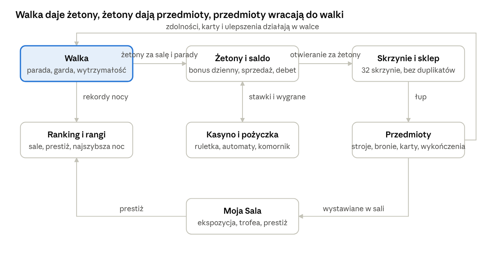

# Kustosz.xyz – opis gry

After Dark Studio · kustosz.xyz · github.com/Dixi2137/noc-eksponatow · 2 listopada 2026

## Zespół i role

| Osoba | Rola | Za co odpowiada |
| --- | --- | --- |
| Jakub Dąbrowski (Mr. Dixi) | Dyrektor kreatywny | Wizja gry i jej 3 zasady, spójność wszystkich pól karty, rozstrzyganie sporów, pomysł w jednym zdaniu, prezentacja gry w teście powtórzenia |
| Jakub Dąbrowski (Mr. Dixi) | Projektant rozgrywki | Pętla pojedynku i przebieg nocy: rytm decyzji gracza, początek i koniec sali, zmieszczenie rozgrywki w 4 minutach z briefu |
| Jan Raźniewski (Yasiecc) | Projektant mechanik | Mechaniki walki w formie „jeśli… to”: parada, osłabiona garda, wytrzymałość; ich jednoznaczność i sprawdzanie luk |
| Jan Raźniewski (Yasiecc) | Badacz doświadczeń gracza | Uczucia gracza przypisane do mechanik, persona i wywiad z odbiorcą, zapis zdania słuchacza i ocena testu |

## Karta Zajęć 1: pola wymagane przez prowadzącego

Ten rozdział zbiera wszystkie pola karty z instrukcji do ćwiczeń. Dalsze rozdziały to pełna dokumentacja gry. Pola oznaczone ☐ zespół uzupełnia na zajęciach.

**Brief** (nr 5 z aneksu, przepisany bez zmian): Gość muzeum · Telefon przy eksponacie · Gra o wybranym zjawisku lub eksponacie · 4 min. Zespół z pary: ☐ (nazwa, numer briefu). Jeśli prowadzący przydzielił inny brief, podmienić tę linię.

**Wniosek z rozgrzewki** (jedno zdanie): AI daje grę „średnią z internetu”, dopóki prompt nie niesie wizji, uczuć i ograniczeń; dopiero runda 3 dała mechaniki z decyzją gracza. ☐ Po prompt battle podmienić na zdanie zespołu.

**Wizja** (3–5 zdań, powstała bez AI): Gość muzeum staje przy eksponacie, a telefon zamienia go w nocnego stróża w zbroi. O północy eksponat budzi się jako postać z historii i staje do pojedynku. Każdy cios przeciwnika jest zapowiedziany, więc wygrywa nie szybszy, tylko ten, kto odczyta rytm. Jedna sala to jeden pojedynek na kilka minut, a historia to przeciwnicy z krwi i kości, nie daty do wkucia.

| Zdanie z wizji | Zasada wizji | Co ta zasada odrzuca |
| --- | --- | --- |
| „Każdy cios przeciwnika jest zapowiedziany” | Każdy cios zapowiedziany | Losowe trafienia, których nie da się przewidzieć |
| „Historia to przeciwnicy, nie daty do wkucia” | Historia to przeciwnik, nie quiz | Pytania o daty i poprawne odpowiedzi |
| „Jedna sala to jeden pojedynek na kilka minut” | Jedna sala, jeden pojedynek | Długie misje i etapy w jednej rozgrywce |

**Pole 1. Pomysł w 1 zdaniu** (dyrektor kreatywny): „Noc w muzeum spotyka pojedynek rycerski, ale każdy eksponat to postać z historii, a wygrywa się tylko odczytując rytm jej zapowiedzianych ciosów.”

**Pole 2. Mechaniki** (projektant mechanik, najwyżej 3):

1. Jeśli gracz naciśnie paradę dokładnie w chwili zapowiedzianego ciosu eksponatu, to cios wraca do atakującego i rycerz nie traci życia; zwykły blok przepuszcza część obrażeń.
2. Jeśli eksponat skończy zamach, to przez chwilę ma osłabioną gardę i tylko wtedy cios rycerza zadaje pełne obrażenia.
3. Jeśli rycerz paruje albo unika, to zużywa wytrzymałość; z pustym paskiem nie może się bronić, aż wytrzymałość się odnowi.

**Pole 3. Pętla i przebieg rozgrywki** (projektant rozgrywki):

1. Gracz działa: widzi zapowiedź ciosu i wybiera paradę, unik albo własny atak (mechaniki 1 i 3).
2. Gra reaguje: cios zostaje odbity, zablokowany z uszczerbkiem albo dochodzi; eksponat po zamachu odsłania gardę (mechaniki 1 i 2).
3. Gracz widzi skutek: paski życia obu stron, pasek wytrzymałości i etykietę (PERFEKCYJNA, BLOK −n, ODRZUT).
4. Gracz decyduje: uderzyć w osłabioną gardę czy odstąpić i odzyskać wytrzymałość przed następną zapowiedzią (mechaniki 2 i 3). Powrót do kroku 1.

Przebieg: rozgrywka zaczyna się o 23:58 ostatnim obchodem i przebudzeniem eksponatu, przy którym stoi gość. Trwa jeden pojedynek w jednej sali, 2–4 minuty. Kończy się ekranem KO i nagrodą w żetonach albo upadkiem rycerza i epilogiem. Pętla powtarza się kilkanaście razy, więc mieści się w 4 minutach z briefu.

**Pole 4. Uczucia gracza** (badacz):

| Uczucie | Mechanika, która je wywołuje |
| --- | --- |
| Napięcie | Mechanika 1: okno perfekcyjnej parady jest krótkie, a cios zapowiedziany |
| Satysfakcja z mistrzostwa | Mechaniki 1 i 2: odbity cios i trafienie w odsłoniętą gardę to zasługa gracza, nie losu |
| Pokusa ryzyka | Mechanika 3: atak z prawie pustym paskiem wytrzymałości daje przewagę, ale odbiera obronę |

**Pole 5. Twist** (cały zespół): mechanika 1 (perfekcyjna parada zeruje obrażenia) plus mechanika 3 (każda obrona kosztuje wytrzymałość). Przewidywane zachowanie: gracze przestaną blokować i unikać, będą stać z pełnym paskiem i czekać wyłącznie na perfekcyjną paradę, bo to jedyna obrona, która nic nie kosztuje. Pojedynek zamieni się w grę rytmiczną, choć nikt jej tak nie zaprojektował.

**Odbiorca: persona od AI, wywiad, zmiana**

| Co przewidziało AI (persona) | Co powiedziała osoba z wywiadu (P1) | Co zespół zmienia |
| --- | --- | --- |
| Marek, 34 lata, zwiedza muzeum z partnerką w weekend, przy eksponacie stoi 1–2 minuty, gra na telefonie tylko w kolejce i w tramwaju. Powody porzucenia: 1) 18-sekundowe intro bez pominięcia, 2) sterowanie klawiszami zamiast dotyku, 3) pierwszy pojedynek za trudny, przegrywa po 20 sekundach | ☐ dosłowny zapis z wywiadu: kiedy ostatnio grał i gdzie, co porzucił i dlaczego, ile ma realnie czasu | Sala 1 jest samouczkiem bez presji; przyciski dotykowe na telefonie; ☐ po wywiadzie: skrócenie albo pominięcie intro przy eksponacie |

**Spory i rozstrzygnięcia**

1. Projektant mechanik chciał, żeby zwykły blok zerował obrażenia tak jak parada. Badacz: wtedy nikt nie ryzykuje perfekcyjnej parady i znika napięcie. Rozstrzygnięte zasadą „Każdy cios zapowiedziany”: tylko trafienie w rytm ma być bezkarne, blok przepuszcza część obrażeń.
2. Projektant rozgrywki chciał obchodu przez kilka sal w jednej rozgrywce. Brief mówi 4 minuty przy eksponacie. Rozstrzygnięte briefem i zasadą „Jedna sala, jeden pojedynek”: kolejne sale to kolejne rozgrywki.
3. Pomysł na pytania o datę bitwy przed walką z bonusem do życia za poprawną odpowiedź. Rozstrzygnięte zasadą „Historia to przeciwnik, nie quiz”: odpada, historię niesie wygląd, broń i styl walki eksponatu.

**Prompt v1** (krok 2, szablon z 5 części)

```
Kontekst: Pracujesz jako doświadczony game designer. Pomagasz zespołowi zaprojektować grę dla gościa muzeum, który gra na telefonie, stojąc przy eksponacie, przez około 4 minuty.

Nasza wizja: Chcemy stworzyć grę, w której gość muzeum staje się nocnym stróżem w zbroi, a eksponat budzi się o północy jako postać z historii i staje do pojedynku. Każdy cios przeciwnika jest zapowiedziany, więc wygrywa ten, kto odczyta rytm. Jedna sala to jeden pojedynek na kilka minut. Historia to przeciwnicy, nie daty. Zasady wizji: Każdy cios zapowiedziany. Historia to przeciwnik, nie quiz. Jedna sala, jeden pojedynek.

Emocje/cel: Gracz ma poczuć napięcie, satysfakcję z mistrzostwa i pokusę ryzyka. Cel klienta: gra o wybranym eksponacie, która przyciąga do niego uwagę gościa.

Struktura odpowiedzi: Zaproponuj w układzie MDA (mechaniki → zachowanie graczy → uczucia): 1) najwyżej 3 mechaniki w formie „jeśli… to” (punkt wyjścia: parada w rytm zapowiedzianego ciosu), 2) pętlę rozgrywki w 4 krokach (działanie gracza, reakcja gry, skutek, decyzja), 3) jak zaczyna się i kończy jedna rozgrywka (punkt wyjścia: jeden pojedynek w jednej sali), 4) jakie uczucia wywołuje każda mechanika.

Ograniczenia: Najwyżej 3 mechaniki. Platforma: telefon, sterowanie dotykowe. Jedna rozgrywka trwa około 4 minut. Bez quizu i pytań o daty. Bez krwi.
```

**Prompt v2** (krok 5): do v1 dopisano w Ograniczeniach „Sala pierwsza jest samouczkiem: przeciwnik wolniejszy, bez kary za spóźnioną paradę” oraz „Perfekcyjna parada to jedyna obrona bez kosztu wytrzymałości”. Powody: persona od AI wskazała za trudny pierwszy pojedynek, a pytanie mechanika o luki pokazało, że bez kosztu wytrzymałości blok i unik da się spamować bez końca.

**AI zaproponowało → zespół zdecydował** (co najmniej 3 wpisy od różnych osób)

| Kto | AI zaproponowało | Decyzja | Dlaczego |
| --- | --- | --- | --- |
| Projektant mechanik | Zwykły blok w pełni zeruje obrażenia, parada tylko dodaje kontrę | Zmienił | Z zasady „Każdy cios zapowiedziany” wynika, że bezkarna ma być tylko parada w rytm |
| Projektant rozgrywki | Rozgrywka to obchód 3 sal z przeskokiem w czasie między nimi | Odrzucił | Brief: 4 minuty przy jednym eksponacie; obchód zostaje jako seria osobnych rozgrywek |
| Badacz | Odruchowy unik bez gardy w każdym pojedynku (gra sama ratuje gracza) | Zmienił | Zostaje tylko w sali 1 jako samouczek; dalej odbierałby zasługę graczowi |
| Dyrektor kreatywny | Quiz o dacie bitwy przed walką jako „element edukacyjny” | Odrzucił | Zasada „Historia to przeciwnik, nie quiz” |
| Cały zespół (twist) | Połączenie mechanik 1 i 3: gracze czekają z pełnym paskiem tylko na perfekcyjną paradę | Wziął | Z pięciu propozycji ta jedyna opisuje zachowanie, nie nową mechanikę |

**Test powtórzenia**

Opis dyrektora na głos: „Stoisz przy eksponacie w muzeum, a telefon robi z ciebie nocnego stróża w zbroi. O północy eksponat budzi się jako postać z historii i atakuje, ale każdy cios zapowiada. Jeśli sparujesz dokładnie w rytm, cios wraca do niego; każda inna obrona kosztuje cię wytrzymałość. Czujesz napięcie przy każdej zapowiedzi i satysfakcję, gdy trafisz w rytm, bo to twoja zasługa, nie losu.”

| Punkt | Pytanie | Czego słucha badacz |
| --- | --- | --- |
| 1 | Co gracz robi? | Paruje w rytm zapowiedzianych ciosów eksponatu |
| 2 | Co czuje albo po co gra? | Napięcie i satysfakcja z trafienia w rytm |
| 3 | Co jest nowe? | Eksponat z muzeum jako przeciwnik z historii, każdy cios zapowiedziany |

Zdanie słuchacza (dosłownie): ☐ do wpisania na zajęciach. Punkty: ☐ z 3.

## Czym jest Kustosz

Kustosz.xyz (robocza nazwa Noc Eksponatów) to przeglądarkowa gra 2D o pojedynkach: rycerz-stróż nocny przechodzi przez 50 sal muzeum i w każdej walczy z eksponatem, który o północy budzi się jako postać z historii, a na końcu schodzi do piekła na Belzebuba. Walka opiera się na czytaniu zapowiedzianych ciosów: parada w rytm odbija cios, cios w osłabioną gardę zadaje pełne obrażenia, a każda obrona kosztuje wytrzymałość. Wokół walki stoi ekonomia żetonów: skrzynie ze strojami, bronią, kartami i wykończeniami, sklep, kasyno, pożyczki i własna sala z trofeami.

| Pytanie | Odpowiedź |
| --- | --- |
| Dla kogo | Gracz, który lubi pojedynki w stylu souls-like i zbieranie kolekcji; historia podana przez przeciwników, nie przez quiz |
| Platforma | Przeglądarka na komputerze i telefonie, bez instalacji; pixel art na canvasie, dźwięk syntezowany |
| Jedna rozgrywka | Jedna sala to pojedynek na 2–4 minuty; pełna noc to 50 sal plus finał |
| Sterowanie | A/D lub strzałki ruch, J/spacja atak, K/Shift parada, L unik, Esc pauza; przyciski dotykowe na telefonie |
| Konto | Opcjonalne (e-mail i hasło, Supabase); gość gra z zapisem lokalnym, konto daje zapis w chmurze, ranking, bonus powitalny i rangi |
| Pieniądze | Skrzynie otwiera się za żetony z gry; ceny w zł i portfel są zapowiedzią, płatności nie są podpięte |

## Świat i fabuła

Stróż nocny w muzeum zasypia przy biurku o 23:58, na ostatnim obchodzie. O 00:00 coś się rusza: eksponaty ożywają, a stróż we śnie staje się rycerzem w zbroi, który musi przejść muzeum sala po sali. Każda sala to inna epoka, od kredy (Velociraptor, T-rex) przez antyk, średniowiecze i nowożytność po XX wiek, a każdy boss to postać historyczna powszechnie uznawana za tyrana, zbrodniarza albo bandytę (żadna żyjąca). Między salami rycerz przeskakuje w czasie: rok przewija się od epoki do epoki, a sceneria zmienia się w błysku. Po ostatniej sali (Kaddafi, 2011) schodzi do piekła, „POZA CZASEM”, na Belzebuba z minigunem. Po nocy stróż budzi się przy biurku o świcie, obok puszki piwa Kustosz.

Założenia świata:

- Historia to przeciwnicy z krwi i kości, nie daty do wkucia. Wiedzę niesie kostium, broń, sceneria i styl walki bossa; karta przeciwnika na pauzie podaje epokę i opis.
- Bossowie są wyłącznie do pokonania: nie wpadają ze skrzyń, nie są kartami ani strojami. Grywalne postacie historyczne to bohaterowie (Zawisza, Joanna d’Arc, Sobieski, Skłodowska, Gagarin…).
- Muzeum jest umowne: 50 sal plus piekło, każda z własną tabliczką nad drzwiami (TERMOPILE, ROMA, BUNKIER…), sztandarami, oknem i cząsteczkami (kurz, śnieg, popiół, płomienie).

## Przebieg nocy

Noc to obchód po salach w kolejności chronologicznej. Gracz zaczyna od sali, do której doszedł poprzednio (pasek sal w menu pozwala wybrać dowolną odblokowaną).

1. **Ekran startowy**: plansza studia, pieczęć kustosza, „Księga gości” z logowaniem, rejestracją albo wejściem jako gość.
2. **Prolog** (tylko przy starcie od sali 1, 18 s): pokój stróża, 23:58 ostatni obchód, 00:00 coś się ruszyło, 00:01 nocna zmiana. Inne sale dostają kartę sali na 2,6 s z nazwą, rokiem i warunkiem sali.
3. **Pojedynek**: jeden boss w jednej sali, do zbicia jego HP do zera albo do upadku rycerza.
4. **Wygrana**: ekran KO, nagroda w żetonach, trofeum do Mojej Sali, panel wyboru: KOLEJNA SALA (przeskok w czasie 4,2 s) albo MENU GŁÓWNE (koniec nocy z zapisem rekordu).
5. **Przegrana albo ostatnia sala**: epilog ze snem stróża i wynikami całej nocy (sale, żetony, czas).

Nagrody: żetony za salę rosną z numerem (120 + 15 × indeks, czyli 120–645 ✦ za zwykłą salę), plus 20 ✦ za każdą perfekcyjną paradę, plus 20 % za salę z warunkiem; przegrana daje 40 ✦. Pełna noc to kilkanaście tysięcy żetonów. Rekordy nocy (pokonane sale, najszybsza pełna noc, żetony z nocy) idą do rankingu.

**Warunki sal** (od czwartej sali, w cyklu z cichymi salami co kilka pokoi) zmieniają reguły pojedynku bez nowych grafik:

| Warunek | Co zmienia |
| --- | --- |
| ZASADZKA | Boss startuje blisko i atakuje od razu |
| SZAŁ | Zamach i odpoczynek bossa ×0,75 / ×0,7 |
| ŻELAZNA GARDA | Krótka słaba garda, droższe bloki |
| SZKLANE OSTRZA | Obie strony zadają ×1,5 obrażeń |
| MARATON | Boss +40 % HP, wytrzymałość gracza ×1,3 |
| CIEMNA SALA | Przyciemniona arena, znak zamachu widoczny dopiero od 65 % |
| ZEGAR | 75 s na walkę, potem rycerz traci 4 HP/s |
| DRUGI ODDECH | Boss przy 35 % HP leczy 25 % i przyspiesza, raz (stały warunek piekła) |
| CIĘŻKA RĘKA | Co drugi atak bossa jest ciężki |

## Walka

Pojedynek jeden na jednego na płaskiej arenie, widok z boku. Boss pilnuje dystansu, zapowiada każdy atak pierścieniem zamachu z wykrzyknikiem, zatrzymuje się na czas zamachu, po ciosie ma okres słabej gardy i odzyskuje dystans. Rycerz ma życie (HP) i wytrzymałość (energię), boss tylko HP.

| Akcja | Co robi | Koszt i skutek |
| --- | --- | --- |
| Atak (J / spacja) | Zamach bronią w zasięgu | Energia zależna od typu broni (ostrza 7, ciężka 10, noże 5). Pełne obrażenia tylko w osłabioną gardę; seria ciosów bronią białą z krótkim odstępem (0,18–0,4 s) i szybszą regeneracją energii w trakcie |
| Blok (K / Shift) | Zwykła garda | Kosztuje wytrzymałość; przepuszcza część obrażeń (pod presją do 40 %, napis BLOK −n) |
| Perfekcyjna parada | Blok dokładnie w oknie ciosu | Zeruje obrażenia i odbija ich część w atakującego (ile, zależy od broni); jedyna obrona, która nie boli; +20 ✦ do nagrody |
| Unik (L) | Odskok | Kosztuje wytrzymałość; pod presją odruchowy unik bez gardy znika, w sali 1 to rzut monetą |
| Cios presji | Trafienie bossa, gdy idzie na gracza | 30 % obrażeń słabej gardy, odrzut (24–56 px zależnie od broni) i chwianie 0,42 s; po nim boss ~1,1 s trzyma równowagę, więc nie ma stun-locka |
| Przerwanie | Trafienie w lekki zamach | 75 % szansy strzałem, 55 % bronią białą, nigdy ciężkiego zamachu; napis PRZERWANY |

Etykiety w walce mówią graczowi, co się stało: PERFEKCYJNA, BLOK −n, ODRZUT, DRAŚNIĘCIE, PRZERWANY, UNIK, PUDŁO, PRZEŁADOWANIE. Pauza (Esc) pokazuje kartę przeciwnika: epoka, opis, styl walki wyliczony z jego profilu, obrażenia, HP, nagroda.

Pętla jednego starcia: gracz widzi zapowiedź i wybiera paradę, unik albo atak; gra odbija, blokuje z uszczerbkiem albo trafia; gracz widzi paski i etykietę; decyduje, czy uderzyć w odsłoniętą gardę, czy odstąpić i odzyskać wytrzymałość. Z połączenia „parada nic nie kosztuje” i „każda inna obrona kosztuje” wynika styl gry, którego nikt nie zaprojektował: gracze czekają z pełnym paskiem tylko na perfekcyjną paradę i pojedynek zamienia się w grę rytmiczną.

## Presja: trudność rośnie z salą

Presja to jedna liczba od 0 do 1 liczona z numeru sali: 0 w sali 1 (samouczek), 0,45 od sali 2 i liniowo do 1 w sali 12 i dalej. Skaluje wszystko, co robi boss, i to, ile wybacza gra, więc te same mechaniki są łagodne na początku i bezlitosne w głębi muzeum. Od sali 4 dochodzą warunki sal i specjalne zagrania bossów.

| Co rośnie z presją | Przy pełnej presji |
| --- | --- |
| HP bossa | do +30 % |
| Obrażenia bossa | do +50 % |
| Koszt bloku w wytrzymałości | do +50 % |
| Długość zamachu bossa | do −30 % (mniej czasu na reakcję) |
| Okno perfekcyjnej parady | kurczy się do 30 % |
| Obrażenia przepuszczane przez zwykły blok | do 40 % |
| Odruchowy unik bez gardy | rzut monetą w sali 1, nie istnieje pod pełną presją |
| Tempo bossa | marsz ×(1 + 1,4p), krótsze przerwy, odpoczynek i dystans; zamiast cofać się, częściej od razu atakuje |
| Szansa, że boss uniknie ciosu w marszu | do 50 % |
| Odrzut i chwianie po ciosie presji | maleją do 40 % |
| Ciężkie ataki | częstsze |

Skutek dla gracza: w sali 1 da się wygrać na zwykłych blokach, od środka obchodu tylko perfekcyjna parada zeruje obrażenia, a niebroniony cios zawsze dochodzi.

## Przeciwnicy: 50 sal i piekło

Każdy boss to wpis w danych (HP, rytm walki: zamach, cios, odpoczynek, dystanse; obrażenia lekkie i ciężkie; kostium na wspólnym rigu postaci). Bossowie-ludzie dzielą jeden pikselowy rig z 16 nakryciami głowy, zarostami, zbrojami, pelerynami i 8 broniami w dłoni, więc nowy boss to jeden wpis danych. Dinozaury to szkielet T-rexa (Velociraptor w skali 0,9).

**Archetypy walki** decydują, jak boss się bije; tier 1–6 skaluje HP (150 + 18 × tier) i obrażenia:

| Archetyp | Styl | Zagranie specjalne (od sali 4) |
| --- | --- | --- |
| Tyran | Wyważony | PODWÓJNY CIOS: po lekkim ciosie drugi z krótkim zamachem (35 %) |
| Osiłek (brute) | Wolny, ciężki co drugi cios, długi odpoczynek | PODWÓJNY CIOS |
| Pojedynkowicz (duelist) | Szybki, rzadko ciężki | FINTA: zamach przerwany w 55 %, zaraz szybki cios ×0,7 |
| Trickster | Lekkie ciosy bez ostrzeżenia, ciężkie z długim zamachem | FINTA |
| Strzelec (gunman) | Pistolet lub karabin z bliska, krótki kontakt | SERIA: drugi strzał z zamachem ×0,45 (50 %) |

**Obchód chronologicznie** (rok, boss, archetyp): Velociraptor i T-rex (kreda, własny rytm) · Nabuchodonozor II, 587 p.n.e., tyran · Leonidas I, 480 p.n.e., włócznia i tarcza · Kserkses I, 479 p.n.e., tyran · Qin Shi Huang, 210 p.n.e., tyran · Sulla, 82 p.n.e., pojedynkowicz · Herod Wielki, 4 p.n.e., trickster · Kaligula, 40, trickster · Neron, 64, tyran · Kommodus, 192, pojedynkowicz · Dioklecjan, 303, tyran · Attyla, 451, osiłek · Czyngis-chan, 1211, pojedynkowicz · Jan bez Ziemi, 1215, trickster · Hulagu-chan, 1258, osiłek · Tamerlan, 1398, tyran · Gilles de Rais, 1440, trickster · Wład Palownik, 1462, trickster · Torquemada, 1483, tyran · Cesare Borgia, 1503, pojedynkowicz · Cortés, 1521, pojedynkowicz · Pizarro, 1532, strzelec · Henryk VIII, 1536, osiłek · Iwan Groźny, 1570, osiłek · Elżbieta Batory, 1610, trickster · Cromwell, 1649, tyran · Czarnobrody, 1718, strzelec · Robespierre, 1794, pojedynkowicz · Napoleon, 1812, szabla · Leopold II, 1900, tyran · Rasputin, 1916, osiłek · Al Capone, 1929, strzelec · Trujillo, 1937, trickster · Franco, 1939, strzelec · Mussolini, 1940, osiłek · Tōjō, 1941, pojedynkowicz · Hitler, 1945, pistolet z bliska · Kim Ir Sen, 1950, strzelec · Stalin, 1953, szaszka, ciężki co drugi · Mao, 1966, tyran · Pinochet, 1973, strzelec · Idi Amin, 1976, osiłek · Pol Pot i Bokassa, 1977, trickster i osiłek · Ceaușescu, 1989, tyran · Saddam, 1991, strzelec · Escobar, 1993, trickster · bin Laden, 2001, strzelec · Kaddafi, 2011, osiłek.

**Finał, sala 51 „POZA CZASEM” (rok 9999)**: Belzebub, tyran tier 8 z 380 HP, rogi, czerwona skóra, peleryna i minigun (strzela z 420 px, seria), ciężki strzał co drugi, obrażenia 20/34, stały warunek DRUGI ODDECH. Sceneria piekła: sztandary 666, płomienie przy cokole, pęknięcia lawy. Trofeum: Camaro Exorcist. Za pokonanie moderator może nadać rangę DEMON SLAYER.

Dodatki w walce: podpowiedzi odmieniają imię bossa poprawnie („rani Kaliguli”, „garda Robespierre’a”), każda sala ma własną scenerię (ponad 25 motywów: rome, persia, china, steppe, pirate, speakeasy, bunker, kremlin, junta, pyongyang, hell…) i trofeum 16×16 px do Mojej Sali (pazur, ząb, tiara, pal, fedora, czerwona książeczka, złoty pistolet…).

## Bronie: 251 sztuk, 7 typów, 5 epok

Broń to dane, nie kod walki: każda ma zasięg, koszt energii, czas zamachu, obrażenia w słabą gardę, bonus serii i to, ile odbija perfekcyjna parada. Typ ustala rytm, epoka decyduje, z których skrzyń wypada, rzadkość dodaje obrażeń (+1 rzadka, +2 epicka, +3 legendarna). Miecz rycerski jest podstawowy i zawsze posiadany. Rycerz trzyma w dłoni to, co ma założone, w pozie spoczynku, zamachu i ciosu.

| Typ | Rytm | Przykłady |
| --- | --- | --- |
| Ostrza | Szybka seria, odstęp 0,26 s, 7 energii | gladius, katana, Szczerbiec, Zulfikar, szabla husarska, zweihänder, szaszka |
| Broń ciężka | Wolna, mocna, odstęp 0,4 s, 10 energii, mocniejsze odbicie parady | topór duński, młot bojowy, morgensztern, berdysz, łom, kij bejsbolowy |
| Broń drzewcowa | Długi zasięg (włócznia 470 px) | pilum, sarissa, trójząb, naginata, halabarda, kopia husarska |
| Noże i sztylety | Najszybsze, odstęp 0,18 s, 5 energii, bonus serii od 2. ciosu | pugio, tantō, kris, rapier, nóż Bowie, kukri, karambit, bagnet M9 |
| Łuki i kusze | Dużo strzał, szybkie ładowanie | proca, łuk długi, yumi, kusza strzemionowa, chu-ko-nu, łuk bloczkowy |
| Pistolety | Średnio: ograniczony bęben, przeładowanie | skałkowy, derringer, Peacemaker, Rewolwer Kustosza, Luger, Colt 1911, VIS, Glock, Desert Eagle |
| Karabiny i strzelby | Mocno i wolno; pistolety maszynowe seriami z małymi obrażeniami | arkebuz, muszkiet, Winchester, Mosin, Garand, Thompson, MP 40, AK-47, M16, Dragunow, Barrett |

Broń dystansowa ma własne reguły: rewolwer ma 6 naboi na walkę, strzał trafia z całej areny, ale tylko w osłabioną gardę; zamach i cios boss odbija, w ruchu uskakuje; po wystrzelaniu bębna przeładowanie 1,6 s bez strzałów, parada działa; HUD pokazuje naboje. Karty broni palnej dodają amunicję.

**Wykończenia** to osobny rodzaj przedmiotu nakładany na dowolną broń: przebarwia stal, krawędź, okucia i trzonek w walce, menu i kolekcji. Katalog ma około 388 powłok w pięciu rzadkościach, generowanych z list kolorów i wzorów: 120 zwykłych (farba, mat, lakier, emalia), 110 rzadkich (paski, kropki, szachownica, metale z kolorową krawędzią), 80 epickich (klejnoty i metale szlachetne), 50 legendarnych (żywioły, animowane) i 28 mitycznych (aurora, plazma, lawa, pryzmat, mgławica, chrom, pieczęć kustosza plus osiem ręcznie robionych: Diamentowy Szmaragd, Złoty Marmur, Tytan, Hologram, Obsydian i Rubin, Stal Damasceńska, Różowe Złoto, Nocna Pustka). Mityczne mają efekty na piksel: iskry, gwiazdy, żyłki, szczotkowanie, żar krawędzi, tęczowe pasy hologramu. Wypadają z Lakierni Muzealnej i Atelier Płatnerza, mityczne z małą wagą z każdej skrzyni (0,35–1,2 %, Sejf Kolekcjonera 3 %); mityczne można też kupić z salda i odsprzedać za 75 % ceny.

## Stroje, zdolności, karty, modyfikatory

**Stroje (skiny)**: 7 pierwotnych, 50 z kolekcji rycerskiej (numery 1–15 zwykłe, 16–30 rzadkie, 31–45 epickie, 46–50 legendarne), Stachu Jones jako prezent (58.) i 27 grywalnych postaci z historii (numery 51+: Aleksander, Cezar, Kleopatra, Zawisza, Joanna d’Arc, Sobieski, Kościuszko, Skłodowska, Piłsudski, Churchill, Gagarin…). Każdy strój ma własną paletę rycerza, motyw hełmu i herbu oraz jedną zdolność, aktywną tylko gdy strój jest założony; zdolności nie sumują się i nie da się zmienić stroju w trakcie pojedynku. Postacie z historii to kostiumy na rigu figurki, jak u bossów.

| Przykładowy strój | Zdolność |
| --- | --- |
| Stara Gwardia (podstawowy) | +20 maks. HP |
| Mroźny Relikt | okno perfekcyjnej parady dłuższe o 0,12 s |
| Czarny Kustosz | 20 % mniej otrzymywanych obrażeń |
| Patyna Wieków | 30 % szybsza regeneracja energii |
| Żar Kuźni | 35 % więcej obrażeń przy przełamywaniu słabej gardy |
| Królewska Warta | 25 % niższy koszt energii parad i uników |
| Słoneczny Paladyn | perfekcyjna parada odnawia 6 HP |
| Stachu Jones | UPÓR STACHA: +30 maks. HP (150 HP) |

**Karty** (53): 33 karty bohaterów i 20 kart broni. Karta bohatera (Spartakus, Pułaski, Hannibal, Chrobry, Saladyn, Musashi, Tomoe Gozen, Washington, Bolívar, Kopernik, Sendlerowa, Pilecki, Mieszko I…) daje jeden pasywny bonus (HP, energia, regeneracja, koszt obrony, okno parady, obrażenia w słabą gardę, leczenie za paradę, redukcja obrażeń, +1 strzał); aktywna jest jedna, wybierana w kolekcji. Karta broni działa sama, gdy założona jest pasująca broń: +10–20 % obrażeń dla broni białej albo +1 do +5 amunicji dla łuku, kuszy, muszkietu, Glocka, AK-47, Barretta. Bossowie nocy nigdy nie są kartami.

**Modyfikatory** łączą się przy starcie walki: zdolność stroju, karta bohatera, karta broni i ulepszenia. Wartości płaskie dodają się, mnożniki mnożą. Ulepszanie ma pięć poziomów (koszt 400 + 600 × poziom ✦): strój +6 maks. HP na poziom, broń +8 % obrażeń w słabą gardę na poziom; sprzedaż kasuje ulepszenia.

**Ukryte pakiety na kod dostępu**: zaszyfrowane AES-GCM zestawy strojów, broni i zdolności, których nie ma w katalogu, skrzyniach ani wyszukiwarce; kod wpisany w oknie Konto odszyfrowuje pakiet i rejestruje go w locie, a kody zapisują się w profilu. Pakiet może nieść własne statystyki walki: szansa pudła, walka pięściami, okrzyki zdejmujące HP (FARMAZON / ODPORNY).

## Ekonomia

Dwie waluty: **żetony ✦** zdobywane w grze (sala, parady, bonus dzienny, sprzedaż, kasyno) i **saldo zł** jako portfel w groszach (bonus powitalny, wygrane w zł, symulowane wpłaty; prawdziwe płatności nie są podpięte). Żetony nie schodzą poniżej zera, saldo może być ujemne (debet, na czerwono w UI; na debecie zakłady i zakupy za zł są zablokowane, wygrana w zł najpierw spłaca dług). Żadna z walut nie ma górnego limitu. Reguła cennika: około 40 żetonów za złotówkę.

| Źródło żetonów | Ile |
| --- | --- |
| Sala | 120–645 ✦ (rośnie z numerem), +20 % za warunek sali |
| Perfekcyjna parada | +20 ✦ każda |
| Przegrana | 40 ✦ |
| Bonus dzienny | 80 ✦ + 40 za każdy dzień serii, do 500; dzień przerwy resetuje; zalogowani liczą go na serwerze (czas Europe/Warsaw), więc zmiana zegara nic nie daje |
| Bonus powitalny | 1000 ✦ i 50 zł raz na nowe konto |
| Sprzedaż przedmiotu | 40 % wartości (zwykły 240, rzadki 700, epicki 1800, legendarny 4500); nie sprzeda się założonego, podstawowego ani prezentu |

**Skrzynie**: 32 skrzynie w grupach: klasyczne (Galeria 900 ✦, Skarbiec Królów 3000 z gwarancją epika, Relikwiarz Legend 7500 z gwarancją legendy), stroje według motywu, cała zbrojownia, broń według typu (Zbrojownia Ostrzy, Kuźnia Ciężka, Sala Drzewcowa, Gabinet Sztyletów, Łucznia, Gabinet Pistoletów, Zbrojownia Karabinów), broń według epoki (Arsenał Antyku… Współczesny), karty (Panteon Bohaterów, Plany Broni, Archiwum Bohaterów), mieszane (Startowa 400, Nocnej Zmiany 1200, Skarbiec Kustosza 4000, Legend 9000), bohaterowie (Galeria Legend 2400), wykończenia (Lakiernia Muzealna 1200, Atelier Płatnerza 6000) i Sejf Kolekcjonera 12 000. Zasady wspólne: rzadkość losowana z wag 55/28/14/3 %, potem równomiernie nieodkryty przedmiot z tej rzadkości; bez duplikatów; po zebraniu rzadkości szanse przeliczają się na resztę; szanse zawsze pokazane przed otwarciem; nagroda zapisana przed animacją (odświeżenie nic nie zjada). Pierwsza Skrzynia Galerii jest darmowa. Otwarcie trwa 8,2 s (pieczęć, przewijanie, zatrzymanie, odsłonięcie), przycisk OTWÓRZ PONOWNIE kręci od razu następną. Promocje są sezonowe w danych (np. Dynia i Krypta Kustosza −40 % 2–3 listopada 2026). Ceny w zł (Galeria 29,99, Skarbiec Królów 79,99, Legend 199,99) są zapowiedzią.

**Pożyczka Kustosza**: jedna naraz, 100–50 000 ✦ albo 10–1000 zł, 2–10 rat, tempo 1/2/3 raty dziennie; odsetki 20/15/10 % od całości zależnie od tempa. Kwota od razu na konto, pierwsza rata po jednym okresie. Zaległe raty ściąga się z funduszy; bez funduszy **komornik** zabiera najcenniejszy sprzedawalny przedmiot i zalicza jego cenę skupu; bez przedmiotów rata idzie w debet na saldzie. Można spłacić ratę albo całość ręcznie. Z debetu wychodzi się wygraną w zł, korektą moderatora albo wpłatą.

## Kasyno Kustosza

Dwie gry losowe w sklepie, obie na żetony albo saldo zł, minimum 10 ✦ / 1 zł, bez górnego limitu. Stawka schodzi od razu, wygrana parkuje się w profilu i księguje po zatrzymaniu animacji oraz przy każdym starcie gry, więc odświeżenie w trakcie nie zjada wygranej ani nie cofa przegranej.

| Gra | Zasady | Wypłaty |
| --- | --- | --- |
| Ruletka | Pasek 15 pól: 7 czerwonych, 7 czarnych, 1 zielone „Kustosz” | czerwone i czarne ×2, zielone ×14 |
| Automaty | Trzy bębny po 16 pól (1 kufel, 2 korony, 3 miecze, 3 czaszki, 3 dynie, 4 monety), środkowy rząd to linia wypłaty; pikselowa szafa z lampkami, wajchą i tacką na monety; autospin 10/25/50/100 | trójka: kufel ×100, korona ×40, miecz ×20, czaszka ×15, dynia ×10, moneta ×6; kufel płaci sam: dwa ×8, jeden ×2; zwrot (RTP) około 91 % |

Kasyno nie używa prawdziwych pieniędzy; saldo zł to wartość w grze.

## Kolekcja, Moja Sala, trofea

**Kolekcja** ma zakładki STROJE / BROŃ / KARTY / WYKOŃCZENIA z wyszukiwarką (ignoruje wielkość liter i polskie znaki), filtrami rzadkości i posiadania oraz stronami po 12. Nieodkryte eksponaty są zablokowane: rozmyta grafika z kłódką, bez nazwy, w osobnej sekcji; kliknięcie mówi, z których skrzyń wypadają. Tu zakłada się strój, broń, kartę i wykończenie, sprzedaje i ulepsza. Licznik „NN / 50” pokazuje postęp kolekcji rycerskiej.

**Moja Sala** to prywatna sala muzealna gracza z nazwą nad wejściem (do 28 znaków) i ośmioma miejscami ekspozycji: dwa postumenty na zbroje, dwa wieszaki na broń, dwie ramy na karty, dwie gabloty na trofea. Miejsce przyjmuje tylko posiadany przedmiot właściwego rodzaju; sprzedany znika z ekspozycji. Sala liczy **prestiż** (punkty za rzadkość wystawionych: podstawowy 1, zwykły 2, rzadki 4, epicki 8, legendarny 16, trofeum 12; +2 za poziom ulepszenia; +20 za pełną salę) i **wartość ekspozycji**. Prestiż jest jedną z kategorii rankingu.

**Trofea** to przedmioty limitowane: po jednym za każdą pokonaną salę (51 z piekłem), nie ma ich w skrzyniach, nie da się ich kupić ani sprzedać. Każde ma własny sprite 16×16 na postumencie z poświatą; nieodkryte to szary znak zapytania z nazwą sali do pokonania.

## Online: konto, ranking, moderacja

Backend to Supabase (logowanie e-mail i hasło, Postgres z Row Level Security). Gra działa jako gość bez konfiguracji; konto jest opcjonalne. Zapis gry (profil) jest po stronie klienta w localStorage i przy każdej zmianie idzie do chmury po 1,2 s oraz przy zamknięciu karty; przy logowaniu wygrywa nowszy zapis. Odzyskiwanie hasła linkiem z maila, potwierdzenie e-maila opcjonalne.

| Element | Co daje |
| --- | --- |
| Ranking | Pokonane sale, prestiż sali, najszybsza pełna noc, żetony z nocy; widoczny też dla gości |
| Rangi honorowe | OWNER, FIRST TO ARRIVE (tylko jedna osoba), FOUNDER, VETERAN, PATRON, DEMON SLAYER (za Belzebuba); kilka naraz, plakietka przy pseudonimie |
| Ogłoszenia | Moderator wysyła komunikat (info, event, warning, sponsored) na 30 s do 7 dni; u graczy ticker nad areną przez WebSocket Realtime, nie da się go zamknąć |
| Tryb serwisowy | Admin włącza ekran PRACE SERWISOWE: walka pauzowana, zapis zablokowany, moderatorzy grają dalej |
| Panel moderatora | Statystyki, wyszukiwarka graczy, żetony ±, saldo ± (korekty trafiają do gracza przez kolejkę i toast „Kustosz zmienił twoje konto”), notatka, ban na godziny albo bezterminowo, reset zapisu, role (gracz / moderator / admin), rangi, ogłoszenia, serwis |
| Bezpieczeństwo | Klient tylko formuje wywołania, uprawnienia sprawdza serwer (RLS, triggery chronią rolę, ban i kolejkę korekt); zbanowany nie zapisze w chmurze |

Admin gry: Mr. Dixi.

## Platforma i technika

Gra przeglądarkowa 2D bez zależności i bez pobierania obrazów: cała grafika to pixel art rysowany na canvasie (scena 288×162 pikseli powiększana ×5 bez wygładzania), sala składana z kafli Kenney Tiny Dungeon (CC0), rycerz 28×40 px i bossowie ze sprite’ów warstwowych z obrysem i trzema tonami cienia, napisy walki w pełnej rozdzielczości nad sceną (czcionka Jersey 10). Dźwięki syntezuje Web Audio. Offline działa jeden plik HTML.

- **Dane, nie kod**: przeciwnicy, bronie, stroje, karty, poziomy, warunki sal, skrzynie, wykończenia i promocje to wpisy w osobnych modułach; nowy boss to jeden wpis.
- **Sterowanie**: klawiatura (A/D, J, K, L, Esc) i przyciski dotykowe; ramka gry dopasowuje się do okna bez przewijania, UI skaluje się proporcjonalnie.
- **Publikacja**: GitHub Pages z domeną kustosz.xyz, wdrożenie przy każdym pushu na main; stare przeglądarki dostają czytelny komunikat zamiast cichego zawieszenia.
- **Testy**: ponad 60 testów walki, ekonomii, sali, chmury, ruletki, automatów i pożyczki uruchamianych w przeglądarce; galerie podglądu wszystkich bossów, broni i póz.
- **Ekran startowy**: plansza studia, pieczęć kustosza, Księga gości; animacje pomijane przy preferencji ograniczonego ruchu.

## Mapa systemów



Rdzeń to jedna pętla: walka daje żetony, żetony otwierają skrzynie, skrzynie dają przedmioty, a przedmioty zmieniają walkę przez zdolności, karty i ulepszenia. Kasyno i pożyczka to boczny obieg żetonów i salda, Moja Sala i ranking to miejsce, gdzie postęp staje się widoczny dla innych.
